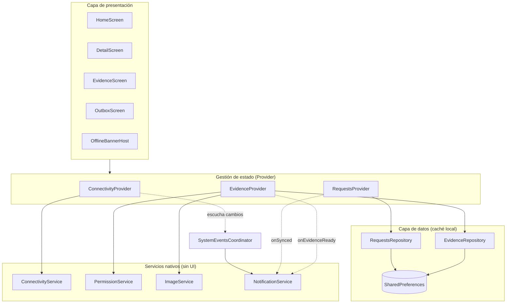

# BugTatsu Sec

Aplicación móvil en Flutter de **BugTatsu Sec**, la versión móvil de mi portafolio de ciberseguridad ofensiva ([portafolio.bugtatsu.xyz](https://portafolio.bugtatsu.xyz)). Muestra reportes de seguridad en formato de catálogo, únicamente con información pública y de alto nivel (sin pasos de reproducción), siguiendo la práctica de divulgación responsable.

Es la evolución de la Actividad Integradora 1 (*Security Portfolio*): se aplicó un rebranding completo y se agregaron servicios nativos.

## Identidad del proyecto

| | |
|---|---|
| Nombre comercial | **BugTatsu Sec** |
| Android `applicationId` | `com.bugtatsu.sec` |
| iOS bundle identifier | `com.bugtatsu.sec` |
| Gestor de estado | Provider |
| Tema | Oscuro tipo terminal (`lib/core/app_theme.dart`) |

Icono y *splash screen* propios generados desde `assets/branding/` con `flutter_launcher_icons` y `flutter_native_splash`.

## Servicios nativos

| Servicio | Qué hace | Código |
|---|---|---|
| Conectividad | Detecta en tiempo real si hay internet (Stream) y muestra un banner *offline* sobre cualquier pantalla. | [`connectivity_service.dart`](lib/services/connectivity_service.dart), [`offline_banner.dart`](lib/widgets/offline_banner.dart) |
| Caché local | Las solicitudes de contacto se guardan primero en el dispositivo y se envían al recuperar la conexión. | [`requests_repository.dart`](lib/repositories/requests_repository.dart), [`requests_provider.dart`](lib/providers/requests_provider.dart) |
| Cámara, galería y permisos | Pide el permiso de cámara en tiempo de ejecución y maneja los casos concedido, denegado y bloqueado. | [`permission_service.dart`](lib/services/permission_service.dart), [`evidence_provider.dart`](lib/providers/evidence_provider.dart) |
| Recorte y compresión | La foto se recorta en cuadrado y se comprime a JPEG en un *isolate* (sin congelar la interfaz). | [`image_service.dart`](lib/services/image_service.dart) |
| Notificaciones locales | Canal nativo de Android y soporte iOS para alertas locales. | [`notification_service.dart`](lib/services/notification_service.dart) |
| Eventos del sistema | Cambios de red, envíos y evidencias disparan notificaciones sin acoplar los módulos. | [`system_events_coordinator.dart`](lib/services/system_events_coordinator.dart) |

## Arquitectura

Los servicios nativos no dependen de ninguna pantalla: la interfaz solo habla con los *providers*, y estos con los servicios y repositorios.



## Estructura del código

| Carpeta | Contenido |
|---|---|
| [`lib/core/`](lib/core) | Tema y paleta de la marca |
| [`lib/models/`](lib/models) | Modelos de datos (`SecurityReport`, `ContactRequest`) |
| [`lib/screens/`](lib/screens) | Pantallas (inicio, detalle, evidencia, solicitudes) |
| [`lib/widgets/`](lib/widgets) | Componentes reutilizables (tarjeta, chip, banner offline) |
| [`lib/providers/`](lib/providers) | Estado con Provider |
| [`lib/services/`](lib/services) | Servicios nativos: red, permisos, imagen y notificaciones |
| [`lib/repositories/`](lib/repositories) | Persistencia local con `shared_preferences` |
| [`assets/`](assets) | Imágenes de los reportes y recursos de marca |
| [`docs/`](docs) | Informe técnico (PDF) y diagrama de arquitectura |

## Instalación y ejecución

Requisitos: Flutter estable, Android Studio con un emulador (o un dispositivo físico) y `flutter doctor -v` sin errores.

```bash
git clone https://github.com/TatsuhiroSattou/portafolio_seguridad_app.git
cd portafolio_seguridad_app
flutter pub get
dart run flutter_launcher_icons
dart run flutter_native_splash:create
flutter run
```

> En Android 13 o superior la app pide el permiso de notificaciones al abrirse. En Android, el permiso de cámara se solicita al pulsar **Tomar foto**.

## Ramas y flujo de trabajo

| Rama | Propósito |
|---|---|
| `main` | Versión estable (rebranding y versión final etiquetada) |
| `develop` | Integración de los servicios nativos |
| `feature/connectivity` | Detección de red y banner offline |
| `feature/offline-cache` | Caché local de solicitudes |
| `feature/camera-permissions` | Cámara, galería, permisos, recorte y compresión |
| `feature/notifications` | Notificaciones locales y eventos del sistema |

Cada `feature/*` se fusiona en `develop` con `--no-ff`, y `develop` se fusiona en `main` al terminar.

## Documentación

Informe técnico completo en [`docs/`](docs): rebranding, arquitectura, explicación de código, pruebas y conclusiones.

## Integrantes

| Integrante | GitHub | Aporte |
|---|---|---|
| Victor Andre Chiquito Toro | [@TatsuhiroSattou](https://github.com/TatsuhiroSattou) | Desarrollo completo (equipo de una persona) |
